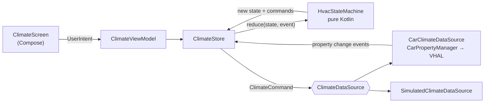
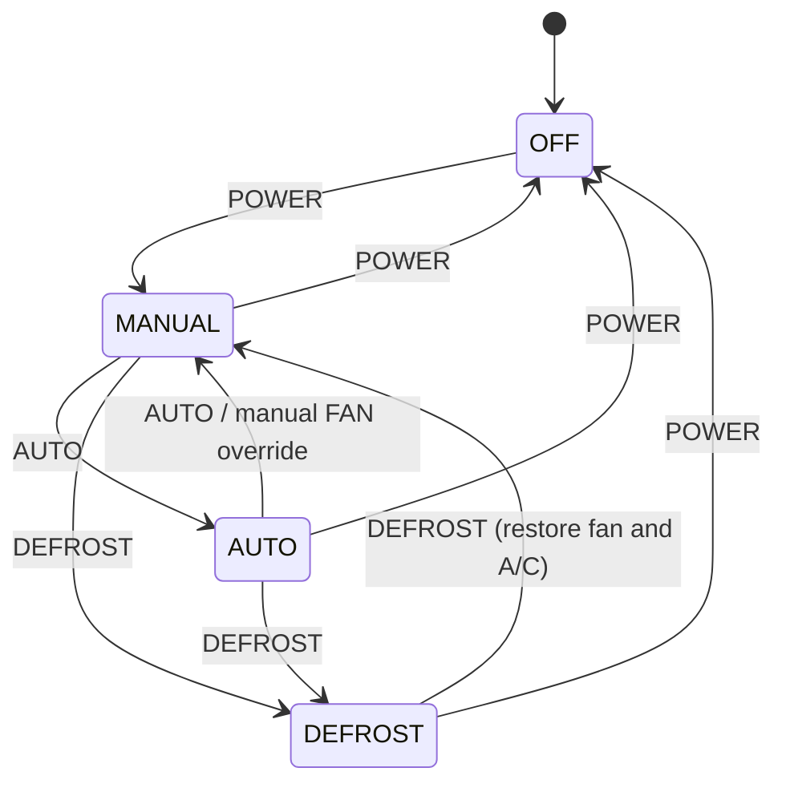

# AAOS Climate Control: Jetpack Compose + VHAL


An HVAC (climate) app for **Android Automotive OS**, built the way production in-vehicle HMI is built:
the vehicle logic is a **pure, tested state machine**, and the Car API is just an adapter around it.

- Reads and writes real **VHAL properties** through `CarPropertyManager`: power, A/C, AUTO, recirculation, fan speed, dual-zone temperature, front defrost
- **Area IDs discovered at runtime** from `CarPropertyConfig`, so nothing is hard-coded per vehicle
- **FSM with guards** (OFF / MANUAL / AUTO / DEFROST) in a JVM-only module with unit tests
- **Design docs generated from code**: the PlantUML state diagram is checked in CI against the transition table
- **Simulated vehicle** fallback, so the HMI runs anywhere (phone, CI, a non-privileged install)
- Automotive UX: dark cabin theme, 88dp touch targets, `distractionOptimized` activity

<!-- Add a screenshot/GIF from the AAOS emulator here: docs/demo.gif -->

## Architecture



**Data flow:** user intent → `reduce` → optimistic UI update → property writes → the vehicle echoes the change → `reduce` again.
The UI always ends up matching what the hardware actually reports.

| Module | Contents |
|---|---|
| `hvac-core` (pure Kotlin/JVM) | `HvacStateMachine`, models, `ClimateStore`, simulator, PlantUML exporter, tests |
| `app` (Android) | Car API adapter, data source selection, Compose HMI |

## State machine



Guards:
- **OFF:** only POWER is accepted.
- **DEFROST:** forces A/C on, fresh air, max fan and AUTO off. A/C, AUTO and recirc are locked. Leaving DEFROST restores the previous fan speed and A/C.
- **AUTO:** a manual fan change is treated as an override and drops back to MANUAL.
- **Temperature:** clamped to the vehicle's range and snapped to its step (read from `HVAC_TEMPERATURE_SET` `configArray`).

The source of truth is `HvacStateMachine.MODE_TRANSITIONS`. `ModeTransitionSpecTest` checks that
the reducer follows every row and that [`docs/hvac-state-machine.puml`](docs/hvac-state-machine.puml) matches it.
To regenerate the diagram after a change, run `./gradlew :hvac-core:test -DupdateDocs=true`.

## Run it

**1. On the AAOS emulator (simulated vehicle)**
1. In Android Studio's Device Manager, create an **Automotive** AVD (for example an Automotive 1408p landscape image).
2. Run `./gradlew :app:installDebug` and open **Climate** from the launcher.
3. The app shows a `SIMULATED VEHICLE` badge, because `CONTROL_CAR_CLIMATE` is a privileged permission.

**2. Driving the real VHAL (privileged install)**
1. Use an Automotive system image **without** Play Store (these allow `adb root`) and start it with `-writable-system`.
2. Run `./gradlew :app:assembleDebug && ./scripts/install-privileged.sh`.
3. After the reboot, the badge is gone. Changes now go through `CarPropertyManager`, and you can watch them in
   the emulator's **Extended controls → Car data** panel or with `adb shell dumpsys car_service`.

> Some images also need `adb disable-verity` and a reboot before `adb remount` works.

**3. Tests**
```bash
./gradlew :hvac-core:test
```

## What I'd add next
Seat heating/ventilation (`HVAC_SEAT_TEMPERATURE`), temperature sync between zones, °C/°F from
`HVAC_TEMPERATURE_DISPLAY_UNITS`, rotary-controller focus support, and screenshot tests.

## License
MIT
